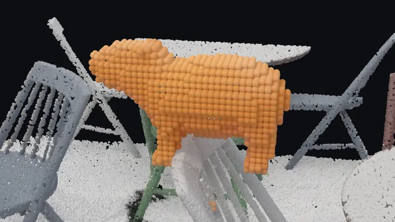
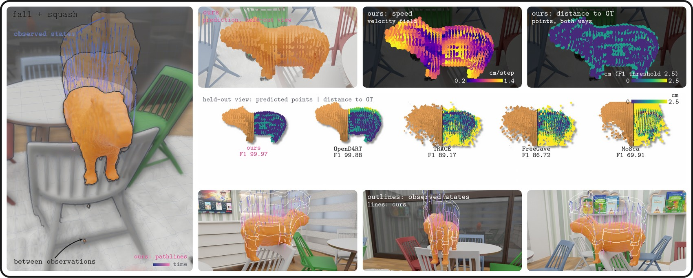
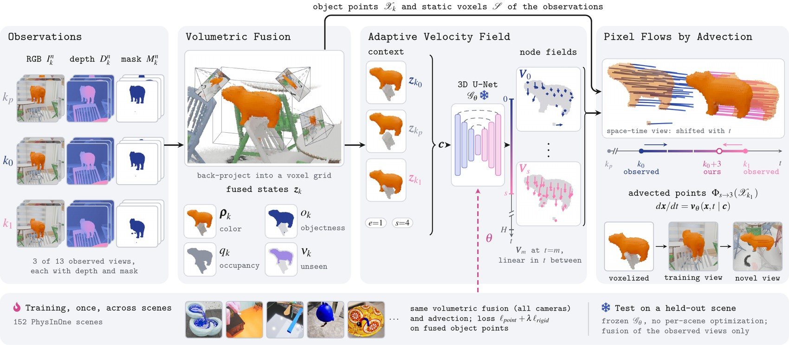

<div align="center">

<div id="user-content-toc">
  <ul align="center" style="list-style: none;">
    <summary>
      <h1>AdaPixFlow: Learning Continuous-Time 3D Dynamics Across Scenes from Sparse Multi-view Observations</h1>
      <i>Under review</i>
    </summary>
  </ul>
</div>

<a href="https://www.python.org/"></a> &emsp;
<a href="https://pytorch.org/"></a> &emsp;
<a href="https://developer.nvidia.com/cuda-toolkit"></a> &emsp;
<a href="LICENSE"></a>

<br><br>

<br>
<em>A held-out scene (PlasticineFall): the object pixels of an observation move along the predicted velocity field to a step between observations.</em>
<br><br>

<div id="toc">
  <ul align="center" style="list-style: none;">
    <summary>
      <h2><a href="#overview">Overview</a> &emsp; <a href="#data">Data</a> &emsp; <a href="#quick-start">Quick Start</a> &emsp; <a href="#training">Training</a> &emsp; <a href="#evaluation">Evaluation</a> &emsp; <a href="#citation">Citation</a></h2>
    </summary>
  </ul>
</div>

</div>

---

## Overview

Predicting how objects move requires recovering their 3D motion from visual observations and predicting their positions at times we never observed, both between sparse observations and after the last one. Existing methods either optimize a velocity field for each scene or impose a predefined physical or kinematic model.

**AdaPixFlow** learns a continuous-time dynamics operator across scenes. We back-project the pixels of all calibrated RGB-D cameras and fuse them into one voxel grid in world coordinates. From the fused observations around a gap, a 3D U-Net predicts a continuous-time velocity field, and we advect the object pixels along it to any target time:

$$\frac{d\mathbf{x}(t)}{dt} = \mathbf{v}_\theta(\mathbf{x}(t), t \mid \mathbf{c}), \qquad \mathbf{c} = (\mathbf{z}_{k_0}, \mathbf{z}_{k_p}, \mathbf{z}_{k_1}, e, s).$$

The operator is trained once, through the advection, by comparing the advected points with the observed object points as unordered sets. It needs no velocity labels, point correspondences, or per-scene optimization.

### Highlights

- **One model for in-between and future prediction.** The context holds the observations on both sides of a gap when they exist, and the past ones otherwise. One forward pass gives the velocity at all 13 integer times of a pass.
- **Closed-form fusion.** The voxel grid is computed directly from depth, masks and the known cameras, so the network only learns how the fused state moves.
- **Point-set supervision.** A Chamfer loss normalized by the error of a static prediction, plus local distance preservation. Neither needs tracks.
- **One command per result.** The configs in `config/physinone/` are the exact settings behind the paper's PhysInOne results, and the released model reproduces them.

---

## Results

<div align="center">

<br>
<em>Left: observed states and our pathlines. Right: predicted 3D object points at a step between observations, against the compared methods, shaded by distance to the ground truth.</em>
</div>

On the six PhysInOne comparison scenes (Tab. 1 of the paper; F1 in %, with views 0 and 1 held out of every input):

| Method | Input | In-between | Future |
| :--- | :--- | :-: | :-: |
| FreeGave | RGB, D<sub>0</sub>, M | 69.1 | 31.5 |
| TRACE | RGB, D<sub>0</sub>, M | 29.9 | 28.4 |
| Shape of Motion | RGB-D, M, 1 view | 67.3 | 31.2 |
| MoSca | RGB-D, M, 1 view | 43.3 | 28.6 |
| SpatialTrackerV2 | RGB-D, M | 87.8 | 50.7 |
| OpenD4RT | RGB-D, M | 84.0 | 45.9 |
| **AdaPixFlow** | RGB-D, M | **90.0** | **58.4** |

On the held-out Test (15) and Val (8) scenes (Tab. 3; F1 in %, Chamfer distance in mm):

| Scenes | s = 2 | s = 4 | s = 8 | Future (10 steps) |
| :--- | :-: | :-: | :-: | :-: |
| Test | 90.9 / 10.4 | 84.2 / 15.8 | 78.7 / 24.0 | 68.3 / 41.5 |
| Val | 99.9 / 4.3 | 97.6 / 5.2 | 90.8 / 9.2 | 55.8 / 42.3 |

---

## Method

<div align="center">

</div>

1. **Volumetric fusion** (`adapixflow/fusion.py`). The voxel grid covers the region in which the objects of a clip move, at 1.25 cm. Each voxel stores color, objectness, occupancy, and an unseen flag. Occupancy rounds each point to its nearest voxel, color and objectness are trilinear averages, and a voxel is unseen when every camera sees it behind its observed depth or not at all.
2. **Dynamics operator** (`adapixflow/model.py`). A 3D U-Net (widths 32, 64, 96, 128, LayerNorm per voxel) maps the three fused states, the flag $e$ and the spacing $s$ to 13 node fields $V_0, \dots, V_{12}$. The velocity is linear in time between nodes and trilinear in space.
3. **Advection** (`adapixflow/flow.py`). A midpoint scheme with both stages at the substep's mid-time integrates the field forward or backward. In-between targets are advected from the nearer observation, future targets from the last one.
4. **Training** (`train.py`, `adapixflow/training.py`). We train on crops of 48³ voxels, over the spacings and horizons we evaluate plus random ones, with a horizon curriculum and a redraw of windows in which too few voxels move.

---

## Repository Structure

```
adapixflow/
├── train.py                      # training entry point (one YAML config per run)
├── evaluate.py                   # held-out (Tab. 3) and comparison-scene (Tab. 1) evaluation
├── adapixflow/
│   ├── fusion.py                 # volumetric fusion of multi-view RGB-D, sparse fused scenes
│   ├── model.py                  # the velocity U-Net and checkpoint loading
│   ├── flow.py                   # node fields, tiled inference, midpoint advection
│   ├── training.py, losses.py    # the batch loss: relative Chamfer + distance preservation
│   ├── data.py                   # splits, moving voxels, evaluation windows, training sampler
│   ├── evaluation.py, metrics.py # the two evaluation protocols, F1 and Chamfer
│   └── config.py                 # every config key and its default
├── dataset/                      # PhysInOne download and conversion, fusion CLI
├── config/physinone/             # train.yaml, heldout.yaml, comparison.yaml: the paper's settings
├── splits/                       # the scenes of every split, and where to download them
├── scripts/                      # download / prepare / train / evaluate
└── tests/                        # unit checks (fusion, advection, model, losses)
```

---

## Installation

Tested on Ubuntu with Python 3.12, PyTorch 2.11 and CUDA 12.8. Install PyTorch first, since its wheel must match your CUDA version.

```bash
git clone https://github.com/HrishikeshVish/adapixflow.git
cd adapixflow
conda create -n adapixflow python=3.12 -y
conda activate adapixflow
pip install torch --index-url https://download.pytorch.org/whl/cu128   # replace cu128 with your CUDA version
pip install -r requirements.txt
python tests/test_core.py                                              # check the install (CPU, a few seconds)
```

**Pretrained model.** Download `adapixflow_physinone.pt` (12 MB) from the [releases page](https://github.com/HrishikeshVish/adapixflow/releases) into `checkpoints/`. It is the model behind every result in the paper.

---

## Data

All data goes under `data/`. Configs use repo-relative paths, so run every command from the repository root.

| Dataset | Scenes | Get it | Prepare |
| :--- | :--- | :--- | :--- |
| PhysInOne | 152 training, 15 Test, 8 Val (6 of them comparison scenes) | `bash scripts/download_physinone.sh` | `bash scripts/prepare_physinone.sh` |

`download_physinone.sh` fetches the 175 scenes listed in `splits/physinone_sources.json` from Hugging Face (121 GB of zips). It converts each one to a 560 px cache (48 GB in total) and deletes the zip. `prepare_physinone.sh` then fuses every scene into `data/physinone/fused` (9 GB). It also fuses the six comparison scenes without views 0 and 1 into `data/physinone/fused_holdout`, on the same grids.

<details>
<summary><b>Notes on the splits</b></summary>

- We selected the training pool from PhysInOne's Train release, balancing phenomena within five tiers: A continuum, B1/B2/C rigid mechanics with one, two or three phenomena, D invisible forces. Granular and light phenomena are excluded. We held out 10% of each tier (seed 0), and trained on the 152 scenes that had been fused when training started.
- The Val scenes are ElasticFall and PlasticineFall on backgrounds 901–904 from `vLAR/PhysInOne` (`Val/SinglePhysics`). Neither their backgrounds nor PlasticineFall appear in training.
- The comparison scenes are DropInLiquid, CrankPush, PanelSpin, DoublePendulum and BalloonLift (five Test scenes), plus ElasticFall (a Val scene).

</details>

---

## Quick Start

With the pretrained model and the prepared data:

```bash
bash scripts/evaluate.sh comparison     # Tab. 1, AdaPixFlow row
bash scripts/evaluate.sh heldout        # Tab. 3
```

Each prints a table and writes per-scene results (including per-step F1) to `experiments/eval/<config>.json`. Use `--scenes <name,...>` with `evaluate.py` to evaluate a subset.

---

## Training

```bash
bash scripts/train.sh config/physinone/train.yaml 0     # -> experiments/physinone/
```

`train.sh <config> [gpu]` runs `python train.py <config>`. Training takes about 4 h on one RTX 5080, including an evaluation every 3,000 steps on a subset of the held-out scenes. The final evaluation at step 24,000 covers every Test and Val scene, and `--resume` continues from `last.pt`. Set `logging.wandb: true` to log to Weights & Biases, and `memory_fraction` to share a GPU. `adapixflow/config.py` lists every key with its default.

---

## Evaluation

| Protocol | Config | Input | Ground truth | Window | Chamfer |
| :--- | :--- | :--- | :--- | :--- | :--- |
| Comparison scenes (Tab. 1) | `comparison.yaml` | fusion without views 0 and 1 | fusion of all views | whole moving region (128³ tiles) | median |
| Held-out scenes (Tab. 3) | `heldout.yaml` | fusion of all views | the same | moving region, capped at 128 voxels | mean |

Both protocols score F1 at 1 and 2 voxels (the paper reports 2 voxels, 2.5 cm). They score only the target steps at which the ground-truth object moved by more than one voxel since the observation before the gap (in-between) or the last observation (future). Results are averaged over the scored steps of a scene, then over scenes. On a GPU, the forward pass runs in bfloat16 as in the paper. On a CPU, it runs in float32, which changes F1 by about 0.1 point.

---

## Citation

```bibtex
@article{adapixflow2026,
  title={AdaPixFlow: Learning Continuous-Time 3D Dynamics Across Scenes from Sparse Multi-view Observations},
  year={2026}
}
```

## Acknowledgments

We thank the authors of [PhysInOne](https://huggingface.co/datasets/vLAR/PhysInOne) for the dataset. Scenes are downloaded from their Hugging Face repositories under their license.

## License

MIT. See [LICENSE](LICENSE).
